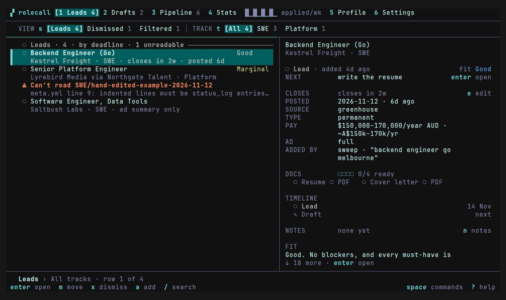

# rolecall

Run your job search from the terminal.

<p align="center">
    <a href="https://github.com/lukebrown14-code/rolecall/releases"></a>
    <a href="https://github.com/lukebrown14-code/rolecall/actions/workflows/go.yml"></a>
    <a href="LICENSE"></a>
</p>

<p align="center">
    
</p>

## What is it?

rolecall is a local job tracker for the terminal. Each Application moves from Lead to Draft to
Applied and on to an Interview, an Offer or a close, and rolecall shows where everything stands:
what is due for a follow-up, which interviews are booked, and how your search is converting.
Every Application is a plain folder of Markdown and YAML in a private git repository on your
machine.

rolecall has no AI of its own: bring your own agent. Pair it with your coding Harness (Claude
Code, Codex, Gemini CLI or opencode) and the rolecall Plugin can capture roles, assess your fit
and write a tailored resume and cover letter, checked against your Profile and built to PDF. The
Harness and rolecall never talk to each other; the Harness writes files in your Workspace and
rolecall shows them. Without a Harness it is a tracker you fill in yourself.

## Installation

macOS and Linux are supported. On Windows, use WSL.

### Install script

No Go needed:

```sh
curl -fsSL https://raw.githubusercontent.com/lukebrown14-code/rolecall/main/scripts/install.sh | sh
```

The script downloads the latest release, verifies its checksum, and installs rolecall with the
Plugin to `~/.local/bin/rolecall`; make sure `~/.local/bin` is on your `PATH`. Run it again to
update (your Workspace and settings are kept). Set `ROLECALL_VERSION=v0.3.0` to pick a release or
`ROLECALL_PREFIX=/usr/local` to install elsewhere.

Or download `rolecall_<os>_<arch>.tar.gz` from the [releases][releases] page, extract it, and keep
the `rolecall` executable next to its `plugin` folder.

### Go

Needs Go 1.21 or newer (Go fetches the toolchain rolecall needs). Put `$(go env GOPATH)/bin` on
your `PATH`.

```sh
go install github.com/lukebrown14-code/rolecall/cmd/rolecall@latest
```

This installs only the executable. For the Plugin, clone the repository and set `plugin` in
`config.toml` to the clone's `plugin` folder.

### Build

```sh
git clone https://github.com/lukebrown14-code/rolecall.git
cd rolecall
go build -o rolecall ./cmd/rolecall
```

The executable finds the Plugin in the `plugin` folder beside it.

[releases]: https://github.com/lukebrown14-code/rolecall/releases

## Getting started

```sh
rolecall init     # creates a rolecall folder here; or pass one: rolecall init ~/jobs
rolecall          # opens the app
```

`rolecall init` asks nothing. It creates the Workspace (a private folder with its own git
repository) and records it in [`config.toml`](#the-config-file). If another Workspace is already
the default, init keeps it and prints how to open the new one; `rolecall init --switch DIR` makes
DIR the default.

1. Run `rolecall` and enter your Contact (Name and Email required; `Esc` skips until next time).
2. [Connect your Harness](#connect-your-harness).
3. In your Harness, run the `create-profile` skill to build your Profile. No Harness? See
   [Use rolecall without a Harness](#use-rolecall-without-a-harness).

Until you add a Lead, the app lists the setup steps left, with the key for each. Add Tracks and a
Search area later under Settings (`6`). `rolecall doctor` checks your setup and `rolecall --help`
lists every command.

To look around first, open the fictional showcase Workspace from the GIF (one Owner, Applications
at every Status, built PDFs) from a source checkout:

```sh
go run ./cmd/rolecall --dir ./examples/workspace
```

## The TUI

Number keys switch screens; `←` `→` (or `s`) switch views; `j` `k` move through rows. `space`
opens the command palette and `?` shows full help for the current screen.

| Key | Action |
| --- | --- |
| `1` to `6` | Leads, Drafts, Pipeline (Applied through Closed), Stats, Profile, Settings (also `,`) |
| `a` | Add an Application |
| `v` / `Enter` | Open the selected Application's details |
| `m` | Move to another Status |
| `x` | Dismiss a Lead or Draft |
| `*` | Mark rows so `x` and `m` act on all of them |
| `u` | Undo the last move or recorded follow-up |
| `e` / `n` | Edit (the row's details, or the file on the current tab) / notes |
| `l` | Record that you followed up today |
| `f` / `p` / `F` | Ask the Harness to assess fit, prepare documents, or draft a follow-up |
| `b` / `d` | Build PDFs / copy them to your Downloads folder |
| `w` / `c` | Open the job ad's link / copy it |
| `/` | Filter by title or company |
| `t` / `T` | Next / previous Track filter |
| `q` | Quit |

Every key is listed under `?` in the app and in [the spec](docs/spec.md#keys).

### Connect your Harness

The Harness is your coding assistant (Claude Code, Codex, Gemini CLI, opencode). Point it at the
Plugin's skills and set the `harness` command in `config.toml` to enable `f`, `p` and `F`. See
[Connect a Harness](docs/harnesses.md).

### Use rolecall without a Harness

A Harness is optional. Without one:

- Set your Editor first (`6`, This machine, `e` on the Editor row). If unset, rolecall uses
  `$VISUAL`, then `$EDITOR`, then `vi`. GUI editors need a wait flag, such as `code --wait`.
- Press `a` to add a Lead (Title and Company required). The first Lead asks for a Track, a kind
  of role such as Nursing or Marketing. Paste the job ad into `jd.md` or add a URL.
- Move Applications with `m`. Moving to Rejected or Withdrawn asks why (optional).
- `e` also sets a next step (date and what it is) and a contact. Next steps show on Applied,
  Interviewing and Offer rows and in Stats.
- On Drafts (`2`), `→` shows Deadlines: open Leads and Drafts by closing date.
- An Application with no news for 14 days (set in Settings) shows `⚑` Follow-up due. Press `l`
  once you have followed up.
- Stats (`4`) shows your funnel (how many ever reached each Status; the tabs count where they
  are now), Response rate and applications per week. Closed means Rejected or Withdrawn;
  Dismissed is counted on its own.
- Write your Profile by hand in `profile/master-profile.md`, which `init` creates with a how-to
  under each heading. On Profile (`5`), `c` edits your Contact and `e` the rest.
- To build PDFs, install the Plugin with `typst`, `pandoc` and `python3` on your `PATH`. Write
  `resume.md` and `cover-letter.md` in the Application's folder and press `b`. Documents are
  checked against your Profile, so keep it current.

### Your CV

A CV is a resume for no particular job, kept as `cv/general.md` (add others beside it). Ask your
Harness to write one, then build it with `b` on the Profile screen (`5`). See
[SCHEMA.md](SCHEMA.md#cv-cvs).

### Make your documents yours

Copy `plugin/templates/brand.typ`, `resume.typ` or `cover-letter.typ` into your Workspace's
`templates/` folder and edit the copy. A copy overrides the bundled file but no longer gets
Plugin fixes. `rolecall doctor` lists the overrides in use. See
[SCHEMA.md](SCHEMA.md#templates-optional-document-template-overrides).

## The CLI

These commands read the Workspace without changing it; each takes `--dir PATH`.

```sh
rolecall now                  # 2 follow-ups due | 1 next step within 7 days | 3 closing within 7 days
rolecall now --days 3 --list  # one tab-separated line per item
rolecall export --format csv --out applications.csv   # or --format json; stdout without --out
rolecall export --ics --out rolecall.ics              # next steps and close dates
```

### Status lines and cron

`rolecall now` prints nothing when nothing is due, so it fits a status line or cron:

```sh
set -g status-right '#(rolecall now) %H:%M'   # tmux
0 9 * * 1-5  rolecall now --dir ~/rolecall    # cron mails only when there is output
```

### Moving from a script

`rolecall move FOLDER STATUS` (for example `rolecall move jobs/SWE/acme applied`) moves an
Application the same way the app does. Applied is refused while its PDFs are not built, unless
you add `--force`.

## The config file

`config.toml` lives at `$XDG_CONFIG_HOME/rolecall/config.toml`, otherwise
`~/.config/rolecall/config.toml`. `rolecall init` writes it, and Settings (`6`) edits it in place,
keeping your comments. If it has an error, `rolecall` and `rolecall doctor` name the line and the
reason.

```toml
workspace = "~/job-search"
editor = ""            # empty = $VISUAL, then $EDITOR, then vi
follow_up_days = 14
downloads = "~/Downloads"
harness = ""           # Handoff command template, e.g. 'claude "/rolecall:{skill} {dir}"'
plugin = ""            # path to rolecall/plugin; falls back to $ROLECALL_PLUGIN
inherit_terminal = false  # use the terminal's ANSI-16 colours, no painted background
ascii = false          # ASCII glyphs
compact_rows = false   # one-line list rows at wide sizes; z toggles it
```

`ROLECALL_THEME=dark` or `light` skips background detection, and `NO_COLOR` turns colour off.
`--dir` overrides `workspace` for one run.

## Privacy

rolecall has no telemetry, server, account or sync. Your data stays in your local Workspace; keep
it private. When your Harness works on your Profile, CV or job text, it sends that content to your
AI provider. See [ADR-0005](docs/adr/0005-owner-data-never-leaves-the-workspace.md).

## Contributing

See [CONTRIBUTING.md](CONTRIBUTING.md). The Workspace file contract is [SCHEMA.md](SCHEMA.md), and
security reports go through the [security policy](SECURITY.md).

## Feedback

Found a bug or want a feature? [Open an issue](https://github.com/lukebrown14-code/rolecall/issues).

## License

[MIT](LICENSE)
